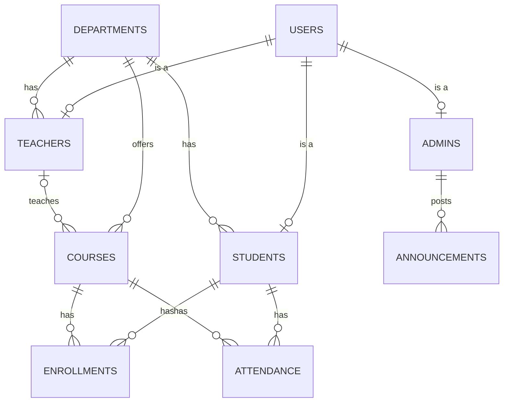

# University Management System

A web app for running a university with three roles: **admin**, **teacher** and **student**.

- **Backend:** Spring Boot 3.3 (Java 21), REST API, Spring Security with JWT, Spring Data JPA, MySQL
- **Frontend:** plain HTML, CSS and a little vanilla JavaScript (no framework, no build step), served by nginx
- **Run with:** Docker Compose (MySQL, backend and frontend)

## Run it

You need Docker with Compose.

```bash
docker compose up --build
```

| What | Where |
|---|---|
| The app | http://localhost:3000 |
| API docs (Swagger UI) | http://localhost:8080/swagger-ui.html |

If a port is already taken on your computer, change it in `.env` (`FRONTEND_PORT`, `BACKEND_PORT`), for example `BACKEND_PORT=8081`. No code change is needed.

Sample accounts (created on first start because `SEED_DEMO_DATA=true`):

| Role | Username | Password |
|---|---|---|
| Admin | `admin` | `admin123` |
| Teacher | `teacher1` | `teacher123` |
| Student | `student1` | `student123` |

**Before using this anywhere real**, copy `.env.example` to `.env` and change the passwords and `JWT_SECRET`, and set `SEED_DEMO_DATA=false`.

### Run without Docker (development)

```bash
# 1. a MySQL 8 database named "ums" with user ums / ums_password (or set DB_URL, DB_USERNAME, DB_PASSWORD)
# 2. backend
cd backend && mvn spring-boot:run
# 3. frontend: static files, but /api must reach the backend. Easiest is the Docker frontend:
docker compose up --build frontend             # nginx forwards /api to the backend container
```
To edit the pages, change the files in `frontend/` and refresh the browser. There is nothing to compile; with Docker, run `docker compose up --build frontend` again to copy them into the image.

Backend tests use an in-memory H2 database, so they need no MySQL: `cd backend && mvn test`.

## What each role can do

| | Admin | Teacher | Student |
|---|---|---|---|
| Create, edit, delete teachers and students | Yes | **No** | **No** |
| Manage departments, courses, enrollments | Yes | No | No |
| Post announcements | Yes | No | No |
| See their own profile | Yes | Yes (read only) | Yes (read only) |
| Change their own password | Yes | Yes | Yes |
| See courses they teach, grade students, take attendance | No | Yes (own courses only) | No |
| Register for or drop courses, see grades and attendance | No | No | Yes (own records only) |
| Read announcements | All | Those for everyone or teachers | Those for everyone or students |
| Sign up for an account (public page) | n/a | Yes | Yes |
| Change a teacher into a student, or a student into a teacher | Yes | No | No |

The rule "only admin can change teacher and student info" is enforced twice: every route that writes profile data lives under `/api/admin/**`, which Spring Security restricts to the `ADMIN` role, and the teacher/student controllers simply have no such endpoint.

## Architecture

```
HTML + CSS + JS ──► nginx ──/api──► Spring Boot ──► MySQL
 static pages         :3000            :8080           :3306 (Docker network only)

Controller  →  Service  →  Repository  →  Entity
 (HTTP, DTOs)  (rules, ownership checks, transactions)  (Spring Data JPA)
```

```
backend/src/main/java/edu/kuet/ums
├── config/       SecurityConfig, OpenApiConfig, DataSeeder
├── security/     JwtService, JwtAuthenticationFilter, AppUserDetails(+Service), JSON 401/403 handlers
├── controller/   thin REST controllers, one per resource
├── service/      business rules and ownership checks
├── repository/   Spring Data JPA interfaces
├── entity/       JPA entities (+ enums)
├── dto/          Requests and Responses (records)
├── mapper/       entity → response DTO
└── exception/    domain exceptions + one global handler
```

### Data model



`Admin`, `Teacher` and `Student` are separate entities that extend one `User` (JPA joined inheritance). They share one login identity and each adds its own columns. Enrollment is a join entity that also carries status and grade.

## Design principles applied

- **Layered architecture, single responsibility.** Controllers handle HTTP only, services hold rules, repositories hold queries. Nothing skips a layer.
- **DTOs at the boundary.** Entities are never bound to requests or returned from the API, so clients cannot set `role` or `id`, and the password hash can never leak. Response field names mirror request field names, so edit forms pre-fill directly.
- **Dependency injection** everywhere (constructor injection), so any piece can be replaced or tested alone.
- **Least privilege and defence in depth.** URL rules by role, plus ownership checks in services (a teacher can only touch their own courses, a student only their own enrollments), plus stateless JWT.
- **Fail the same way every time.** One `GlobalExceptionHandler` returns the same JSON error shape (`status`, `message`, `path`, `fieldErrors`) for validation, conflicts, 401, 403 and 404.
- **Validate at the edge.** Bean Validation on every request record; business rules (unique username, no future attendance, only active students get attendance) in services.
- **Don't repeat yourself.** The frontend drives all admin tables from one configurable `UMS.crud(...)` function, and every dashboard is built from the same few chart pieces (KPI tile, bar list, stacked bar, meter), all drawn with HTML and CSS only.
- **Config from the environment.** Secrets, database and seed settings come from environment variables (twelve-factor), with safe development defaults.

## Security notes

- Passwords are stored with BCrypt. Tokens are HS256 JWTs (8 hours by default). The user is reloaded on every request, so disabling or deleting an account takes effect immediately instead of when the token expires.
- CSRF protection is off on purpose: the API is stateless and uses a bearer header, not cookies.
- The frontend keeps the token in `localStorage` so a refresh keeps you signed in. Any script on the page can read it, so the pages build all markup through an escaping `html` helper and never insert raw user text. Moving to short-lived tokens in httpOnly cookies is the next hardening step if you need it.
- **Public sign-up** (`/signup.html`) only creates students and teachers, never admins. It has no CAPTCHA or rate limiting, and a teacher can register with any employee ID, so for a real deployment set `SIGNUP_REQUIRE_APPROVAL=true` (new accounts stay disabled until an admin switches them on) or `SIGNUP_ENABLED=false`. The first admin is created from `ADMIN_USERNAME` / `ADMIN_PASSWORD` on first start.
- Swagger UI is open so you can explore the API. Disable it (`springdoc.swagger-ui.enabled=false`) for production.

## API reference

All endpoints except login need `Authorization: Bearer <token>`. Errors look like `{ "status": 400, "message": "Validation failed", "path": "...", "fieldErrors": { "email": "..." } }`.

**Public (no login)**
| Method | Path | Purpose |
|---|---|---|
| GET | `/api/public/signup-info` | `{ enabled, requireApproval, departments }` for the sign-up form |
| POST | `/api/auth/register` | Sign up as `TEACHER` or `STUDENT` (201), 403 if sign-up is off |

**Auth (any role)**

| Method | Path | Purpose |
|---|---|---|
| POST | `/api/auth/login` | `{ username, password }` returns `{ token, user }` |
| GET | `/api/auth/me` | Current user |
| POST | `/api/auth/change-password` | `{ currentPassword, newPassword }` |

**Shared reads (any role)**: `GET /api/departments`, `GET /api/courses`, `GET /api/announcements` (filtered by role)

**Admin only (`/api/admin/**`)**

| Resource | Endpoints |
|---|---|
| Teachers | `GET/POST /teachers`, `GET/PUT/DELETE /teachers/{id}`, `POST /teachers/{id}/convert-to-student` `{ studentId, batch?, semester?, departmentId? }` |
| Students | `GET/POST /students`, `GET/PUT/DELETE /students/{id}`, `POST /students/{id}/convert-to-teacher` `{ employeeId, designation?, qualification?, joiningDate?, departmentId?, deleteRecords? }` |
| Departments | `GET/POST /departments`, `GET/PUT/DELETE /departments/{id}` |
| Courses | `GET/POST /courses`, `GET/PUT/DELETE /courses/{id}` |
| Enrollments | `GET/POST /enrollments`, `DELETE /enrollments/{id}` |
| Announcements | `GET/POST /announcements`, `PUT/DELETE /announcements/{id}` |
| Stats | `GET /stats` (totals, enrollment status split, attendance rate, students per department, top courses) |

On update, a blank `password` keeps the current one.

**Teacher only (`/api/teacher/**`)**

| Method | Path | Purpose |
|---|---|---|
| GET | `/profile` | Own profile (read only) |
| GET | `/courses` | Courses they teach |
| GET | `/stats` | Their students, grading progress and attendance per course |
| GET | `/courses/{id}/students` | Class roster |
| PUT | `/enrollments/{id}/grade` | `{ grade: "A" }` (A+ through F, blank clears) |
| GET | `/courses/{id}/attendance?date=YYYY-MM-DD` | Saved attendance for a day |
| POST | `/courses/{id}/attendance` | `{ date, entries: [{ studentId, status }] }`, re-posting a date updates it |

**Student only (`/api/student/**`)**

| Method | Path | Purpose |
|---|---|---|
| GET | `/profile` | Own profile (read only) |
| GET | `/enrollments` | Own courses, status and grades |
| POST | `/enrollments` | `{ courseId }` registers (re-registers after a drop) |
| DELETE | `/enrollments/{id}` | Drops a course (completed courses cannot be dropped) |
| GET | `/attendance` | Own attendance records |

## Sign-up, role change and dashboards

- **Sign-up:** `/signup.html`, linked from the sign-in page. Students give a student ID, teachers an employee ID. With open sign-up the new person is signed in straight away.
- **Role change (admin only):** on the Teachers page choose **Change to student**, on the Students page **Change to teacher**. The login (username, password, email, name, phone, address) stays. Role-specific details are replaced by the ones you enter.
  - Teacher to student: the courses they taught become unassigned; attendance they recorded is kept.
  - Student to teacher: their enrollments, grades and attendance are **deleted**. The API answers 409 until the request carries `deleteRecords: true`, which the form sends when you tick the box.
  - Someone already signed in is moved to the right dashboard the next time they open a page that now refuses them.
- **Dashboards:** the admin sees KPI tiles, enrollment status, attendance rate, students per department, most-enrolled courses and a needs-attention list. Teachers see per-course student counts, grading progress and attendance. Students see course status, credit hours and attendance per course. Attendance under 75% is flagged with a warning icon and label, not by colour alone.

## Behaviour worth knowing

- Deleting a **teacher** keeps their courses (unassigned) and attendance history.
- Deleting a **student** or **course** also deletes the related enrollments and attendance.
- A **department** with teachers, students or courses cannot be deleted (409).
- Attendance counts "present" and "late" as attended.

## Tests

`backend/src/test/java/.../SecurityAndCrudIntegrationTest.java` runs the full app against H2 and checks: public sign-up (login straight after, duplicates, missing IDs, admin role refused), teacher-to-student and student-to-teacher conversion (including the confirmation rule), dashboard statistics, login and 401 handling, role separation (403s), that only admin can update or delete students and teachers, validation and conflict responses, grading and attendance ownership, student self-enrollment, role-filtered announcements, and password change.
